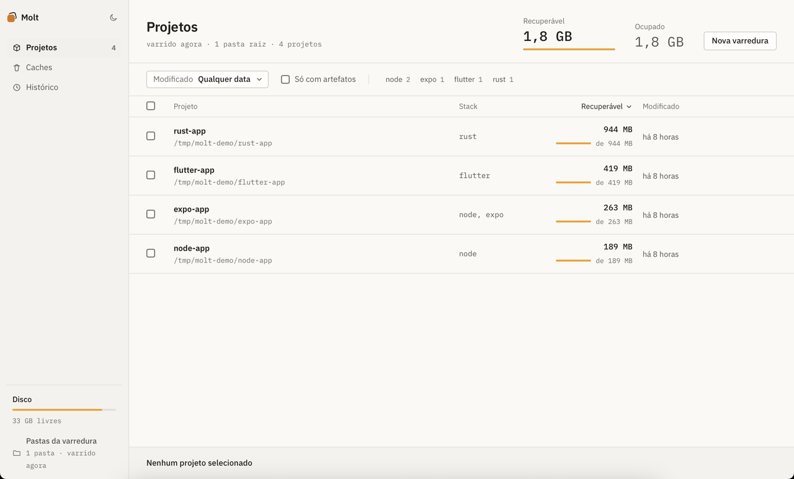
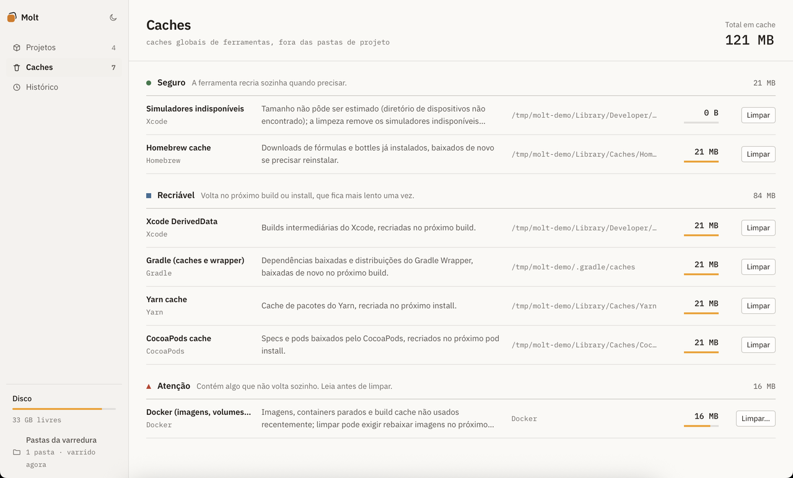
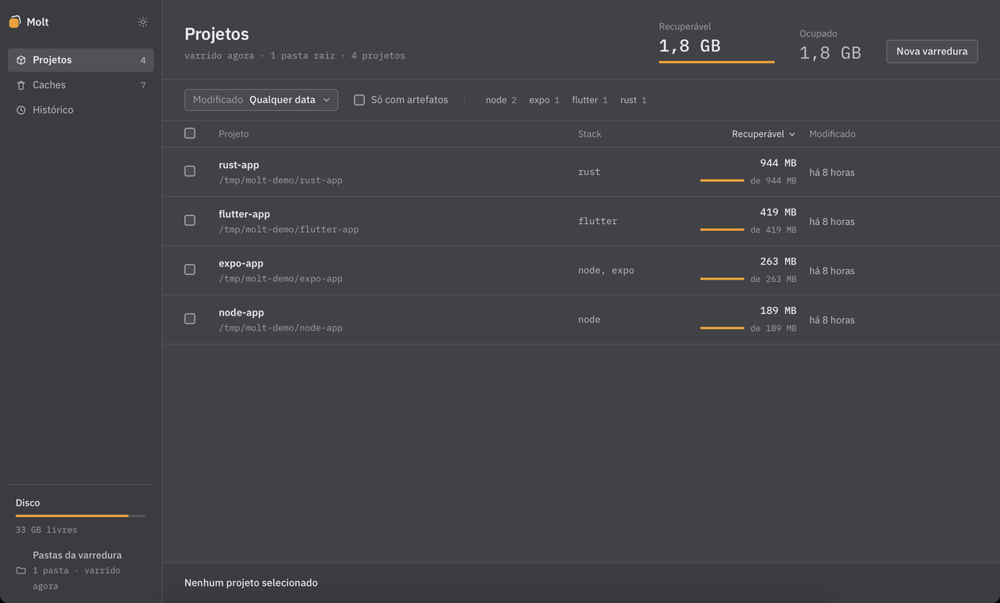

<p align="center">
  
</p>

<p align="center">
  Encontre projetos antigos. Libere espaço com segurança.
</p>

App desktop para macOS que encontra projetos de código no seu disco, mostra quanto
espaço cada um ocupa e separa o que é seguro apagar (porque é regenerável) do que não é.

Feito porque `~/Developer`/`~/Projects` acumula `node_modules`, `target/`, `build/`,
`Pods` e caches de ferramentas (Xcode, Gradle, npm/pnpm/yarn, CocoaPods, Homebrew,
Docker) de projetos que você nem lembra que existiam, e descobrir o que dá pra liberar
sem medo de quebrar algo é manual e chato.

Molt não é um "otimizador de sistema": não libera RAM, não mata processos, não limpa
`~/Library/Caches` inteiro. Ele só sabe sobre artefatos de build e caches de dev
conhecidos, e só apaga o que você confirmar explicitamente.

## Screenshots

<p align="center">
  
</p>

<p align="center">
  
</p>

<p align="center">
  
</p>

<p align="center">
  
</p>

## O que ele faz

1. **Varredura de projetos** — você escolhe as pastas raiz (ex.: `~/Developer`); o
   Molt varre recursivamente, identifica a stack de cada projeto (Node, Rust, Python,
   Flutter, React Native, Expo, Swift, Android, Go, Java), acha os artefatos
   regeneráveis dentro dele (`node_modules`, `target`, `.next`, `venv`, `__pycache__`,
   `build`, `Pods`, `dist`...) e mede o tamanho real em disco de cada um.
2. **Estado git** — para projetos versionados, mostra se há mudanças não commitadas e
   se há commits não enviados ao remoto, para você não apagar algo que só existe
   localmente.
3. **Catálogo de caches de dev** — lista separadamente o cache de ferramentas
   (DerivedData e arquivos antigos do Xcode, simuladores indisponíveis, AVDs do
   Android, Gradle, npm, pnpm, yarn, CocoaPods, cache do Cargo, Composer, Homebrew,
   Go build cache, Docker) com o tamanho de cada um.
4. **Limpeza segura** — você escolhe o que apagar; o Molt sempre manda para a Lixeira
   do macOS (nunca `rm -rf`), nunca segue symlinks e recusa apagar um projeto com
   mudanças não commitadas, a menos que você confirme explicitamente. Dá pra ignorar
   um projeto específico, removendo-o das próximas varreduras.
5. **Histórico** — toda limpeza fica registrada, com o que foi apagado e quanto espaço
   foi liberado.
6. **Indicador de disco** — a barra lateral mostra o espaço livre/ocupado do volume em
   tempo real e, depois de cada limpeza, quanto espaço acabou de ser liberado.

Tema claro e escuro, com alternância pela barra lateral.

## Como usar

1. Abra o Molt e escolha as pastas raiz onde você guarda projetos (ex.: `~/Developer`,
   `~/Code`). Dá pra digitar o caminho ou usar o seletor de pasta.
2. Clique em "Começar varredura". O Molt mostra os projetos encontrados, quanto espaço
   total cada um ocupa e quanto é recuperável.
3. Confira a aba de Caches para ver o que ferramentas de dev acumularam fora dos
   projetos.
4. Selecione o que quer apagar e confirme. Tudo vai para a Lixeira — se mudar de ideia,
   é só restaurar de lá.

Para o Molt enxergar projetos fora de pastas sandboxed e detectar caches de
ferramentas como Xcode e simuladores, o macOS normalmente exige a permissão
**Acesso Total ao Disco**:

1. Abra **Ajustes do Sistema -> Privacidade e Segurança -> Acesso Total ao Disco**.
2. Adicione o `Molt.app` e habilite a permissão.
3. Reinicie o app.

Sem essa permissão o Molt continua funcionando, mas pode pular diretórios/caches
protegidos pelo macOS e subestimar tamanhos.

## Build a partir do código

Pré-requisitos: [Rust](https://rustup.rs/) estável, [Node.js](https://nodejs.org/) 20+,
[pnpm](https://pnpm.io/) e [`just`](https://github.com/casey/just). Testado em macOS;
o resto do sistema de arquivos usado (symlinks, `st_blocks`, Lixeira) é específico de
Unix/macOS.

```bash
pnpm install
just dev          # app em modo dev
just build        # gera .app e .dmg em src-tauri/target/release/bundle
```

Outros comandos úteis (ver `justfile` e `AGENTS.md`):

```bash
just check          # fmt, clippy, testes Rust, typecheck, lint, testes do frontend
just fixtures-demo   # cria um HOME falso em /tmp/molt-demo com projetos e caches
                     # de exemplo, para testar a UI sem tocar no seu HOME real
```

## Arquitetura e estrutura do código

Molt é um app [Tauri 2](https://tauri.app/): um binário Rust expõe comandos via
`invoke()` para um frontend React/TypeScript. O Rust nunca abre UI própria — toda
interação é via comandos e eventos do Tauri.

```
src-tauri/src/
  model.rs      contratos compartilhados com o frontend (espelho manual em src/types.ts)
  scanner/      varre o disco e mede tamanho (jwalk + rayon, paralelo)
  detectors/    identifica stack, artefatos regeneráveis e estado git de um projeto
  caches/       catálogo de caches de ferramentas de dev (Xcode, Gradle, npm, Docker...)
  cleanup/      deleção segura (sempre via Lixeira), respeitando dry_run e git sujo
  commands.rs   liga tudo ao Tauri (#[tauri::command])
  testkit/      fixtures de HOME falso usadas pelos testes e por just fixtures-demo

src/
  api/          chamadas ao backend via invoke() (única porta de entrada para o Rust)
  components/   UI React (onboarding, projetos, caches, histórico)
  store/        estado global (zustand)
  hooks/        hooks de dados (React Query sobre src/api)
  types.ts      espelho de src-tauri/src/model.rs
```

Decisões de design relevantes (detalhadas em `docs/architecture.md`):

- **Tamanho em disco = blocos alocados (`st_blocks * 512`), nunca `st_size`** — o que
  corresponde ao que o Finder/`du` mostram, mesmo em arquivos esparsos ou comprimidos.
- **Hardlinks são deduplicados por `(dev, ino)`** dentro de cada varredura, para não
  inflar o "espaço recuperável" de stores de conteúdo endereçável (como o do pnpm).
- **Symlinks nunca são seguidos**, nem para medir tamanho nem para apagar.
- **Toda deleção passa pela Lixeira do macOS** (crate `trash`); o código nunca chama
  `remove_dir_all` fora de testes.
- **Comandos externos** (`brew --cache`, `xcrun simctl`, etc.) rodam sem shell, com
  timeout, resolvendo o binário pelo `PATH`.

## Contribuindo

Veja `AGENTS.md` para o mapa completo do código, convenções de branch/worktree e o
fluxo de Pull Request. Resumo: tudo entra por PR contra `main`, com `just check` verde
e testes cobrindo o comportamento novo.

## Licença

[MIT](LICENSE).
